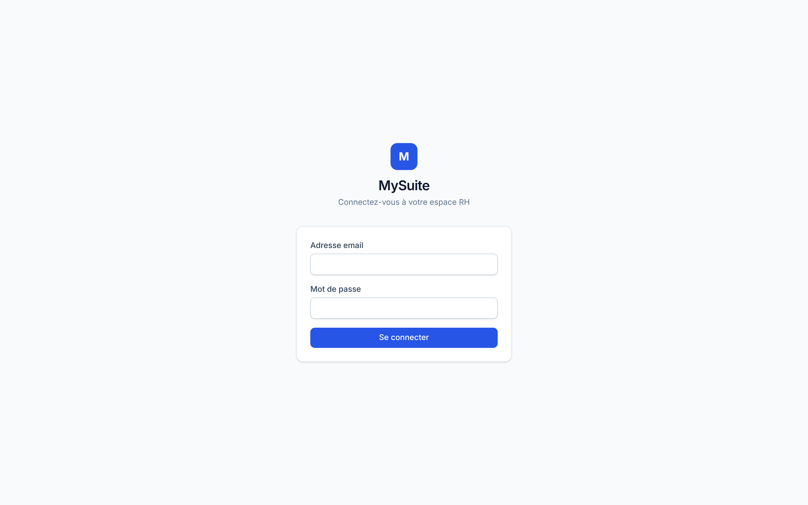

# Premiers pas

## Comptes de démonstration

Après `seed-demo` (mot de passe `Demo-Passw0rd-2026`, **jamais en production**) :

| Compte | Rôle |
|---|---|
| `rh@demo.test` | Administrateur RH |
| `paie1@demo.test`, `paie2@demo.test` | Responsables de paie (deux personnes pour le principe des quatre yeux) |
| `manager@demo.test` | Manager |
| `employe@demo.test` | Employé |
| `audit@demo.test` | Auditeur |

## Mettre en place une vraie société

1. **Administrateur de plateforme** : `mysuite create-admin`, puis connexion. Page **Plateforme** → créer la société et son premier administrateur RH.
2. **Administrateur RH** : se connecter, activer le [MFA](../guide/securite-compte.md).
3. **Organisation** : créer sites, départements, postes ([guide](../guide/organisation.md)).
4. **Employés** : créer les dossiers et la rémunération ([guide](../guide/employes.md)).
5. **Utilisateurs** : créer les comptes et attribuer les rôles ([guide](../guide/utilisateurs.md)).
6. **Congés** : définir les types et les soldes ([guide](../guide/conges.md)).
7. **Pointage** : régler fuseau et tolérances, déclarer les badgeuses ([guide](../guide/pointage.md)).
8. **Paie** : saisir un jeu de règles avec sa source officielle, le faire approuver par une seconde personne, puis préparer une première paie en simulation ([guide](../guide/paie.md)).

## Multi-sociétés

Un utilisateur peut appartenir à plusieurs sociétés. La première est choisie à la connexion ; le changement de société se fait depuis le sélecteur de l'en-tête, visible dès qu'il y a plusieurs sociétés. Les données d'une société ne sont jamais visibles depuis une autre.
