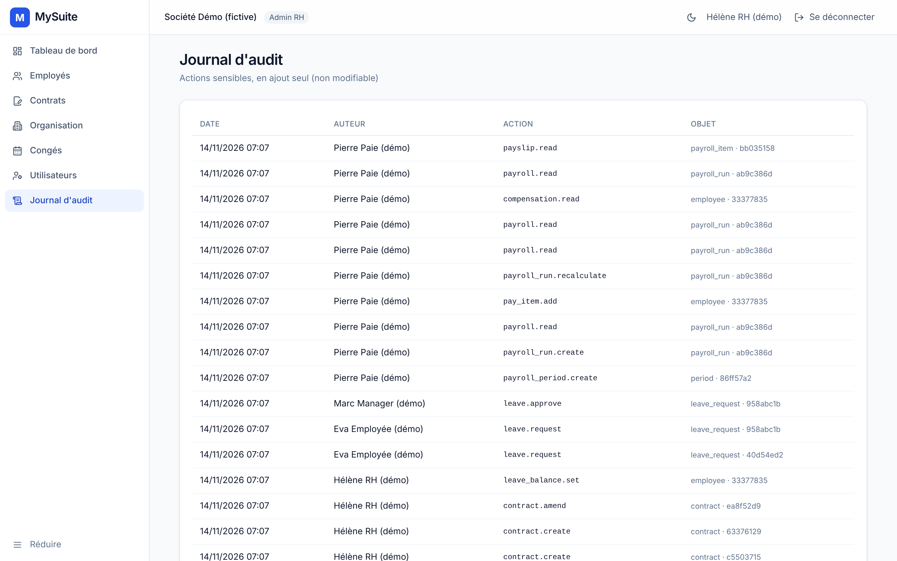

# Journal d'audit

Accessible à l'admin RH et à l'auditeur. Le journal est **en ajout seul** (triggers SQL interdisant modification et suppression) et enregistre : qui, quand, quelle action, quelle ressource, et un détail (avant/après pour les corrections).

Exemples d'actions : `payslip.download`, `attendance.export`, `attendance.device_ingest`, `attendance.import`, `mfa.enable`, `mfa.disable`, `mfa.admin_reset`, `user.password_reset_issued`, `user.password_reset`, lecture de rémunération, approbation de règles de paie.

Pagination `?page=&limit=`.
