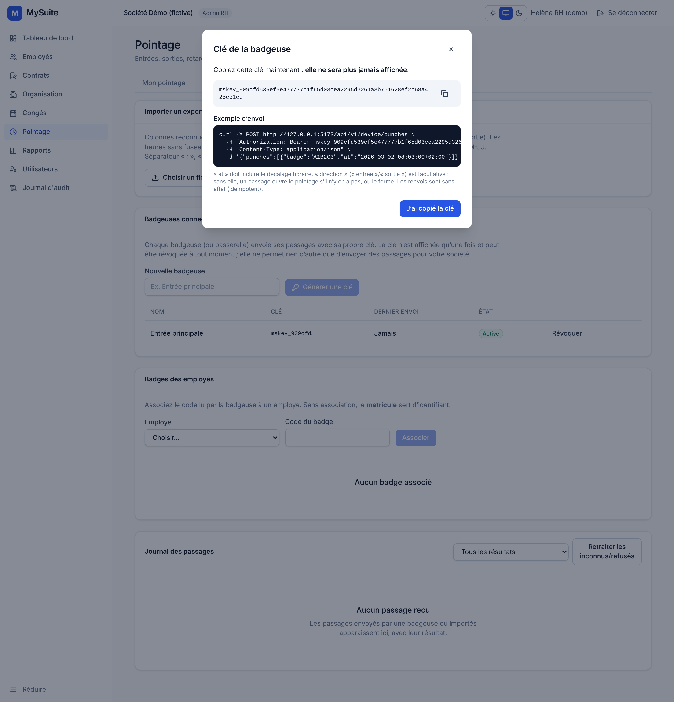
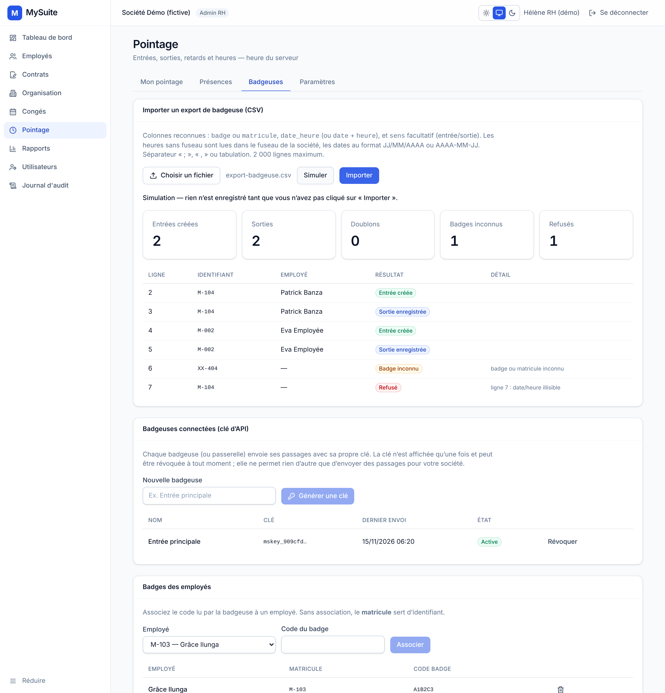
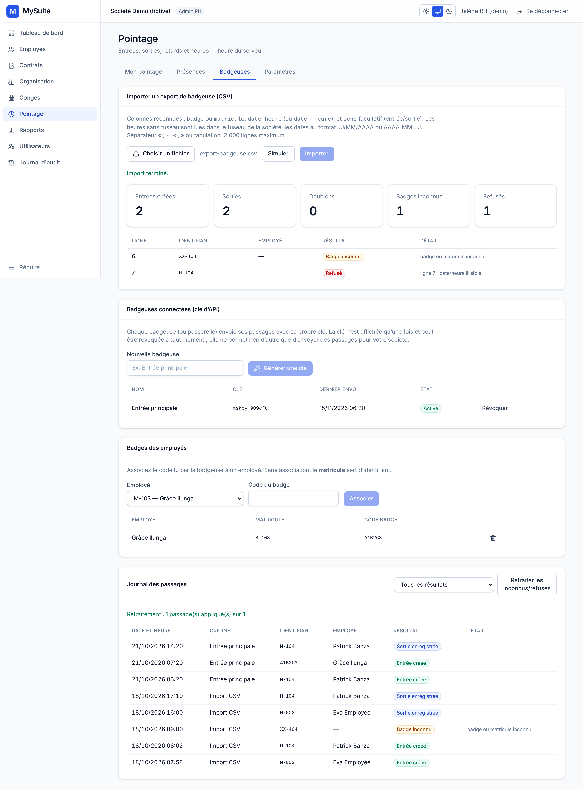

# Badgeuses

Deux voies d'alimentation du pointage, en plus du libre-service.

## 1. API appareil

1. Pointage → onglet **Badgeuses** → **Nouvelle badgeuse** → *Générer une clé*.

    

    La clé (`mskey_…`) **n'est affichée qu'une fois**. Seule son empreinte est stockée ; elle est révocable.

2. Associer un **badge** à chaque employé (à défaut, le **matricule** sert d'identifiant).
3. Le matériel (ou une passerelle) envoie les passages :

```bash
curl -X POST https://votre-domaine/api/v1/device/punches \
  -H "Authorization: Bearer mskey_xxx" \
  -H "Content-Type: application/json" \
  -d '{"punches":[
        {"badge":"A1B2C3","at":"2026-11-16T07:58:12+02:00"},
        {"badge":"A1B2C3","at":"2026-11-16T17:03:40+02:00","direction":"out"}
      ]}'
```

- Heures **RFC 3339 avec décalage**, 500 passages par envoi, `direction` facultative (`in`/`out`) — sinon bascule automatique.
- **Idempotent** : renvoyer le même lot est sans effet ; double badgeage à moins de 60 s ignoré.
- Réponse : résultat par passage + compteurs (`entries_opened`, `entries_closed`, `duplicates`, `unknown_badges`, `rejected`).
- Pas de cookie ni de CSRF : l'authentification est la clé seule.

!!! info "Protocoles propriétaires"
    ZKTeco et autres protocoles ne sont pas natifs. Une petite passerelle peut les traduire vers l'API ci-dessus.

## 2. Import CSV



Importer l'export de la badgeuse (2 000 lignes max). **Simulation** d'abord : rien n'est écrit ni audité. Les heures sans fuseau sont lues dans le fuseau de la société ; dates `JJ/MM/AAAA` ou `AAAA-MM-JJ`.

## Journal des passages



Tous les passages reçus sont conservés, y compris les **refus** (badge inconnu, employé inactif, chevauchement, pointage ouvert depuis plus de 16 h…). Après correction (badge associé, pointage fermé), **Retraiter** les rejoue dans l'ordre chronologique.
