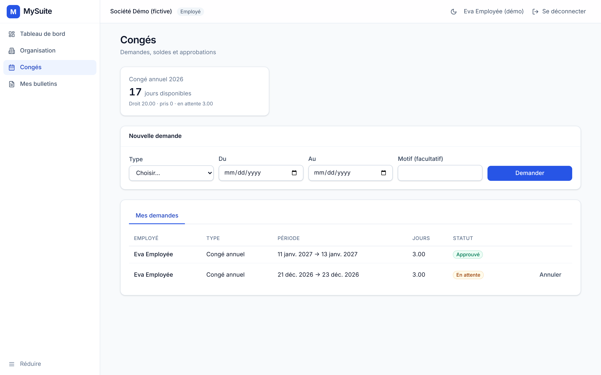
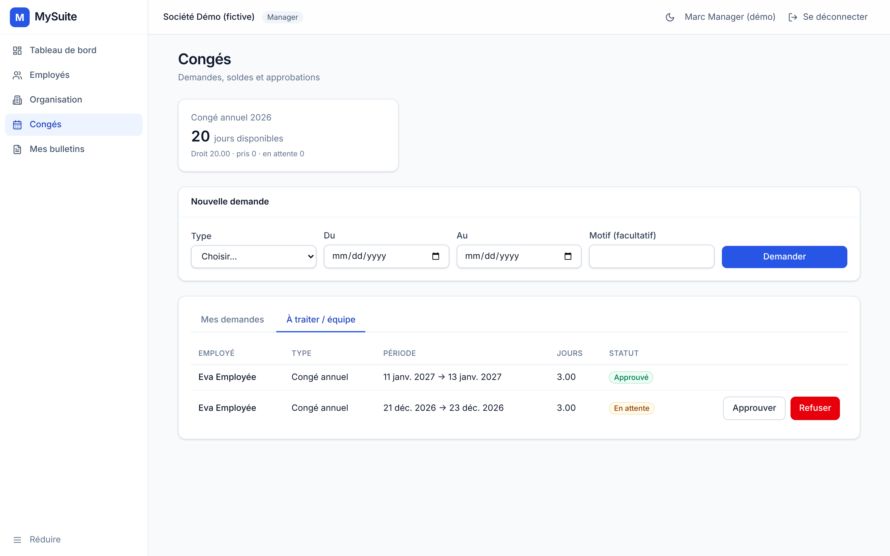

# Congés

=== "Employé"
    

    1. **Nouvelle demande** : type, dates, motif facultatif.
    2. Le solde affiché tient compte des demandes approuvées **et en attente**.
    3. Annulation possible tant que la demande n'est pas close.

=== "Manager"
    

    Les demandes de vos subordonnés directs apparaissent dans « Demandes à traiter » : approuver ou refuser (motif). Vous ne pouvez pas décider de votre propre demande.

=== "RH"
    Définir les **types de congé** (droit annuel, avec ou sans solde), saisir les **soldes** par employé, consulter toutes les demandes.

Les jours décomptés sont les jours ouvrés lundi–vendredi ; **les jours fériés ne sont pas pris en compte**. Détails : [règles de congés](../business-rules/leave.md).
