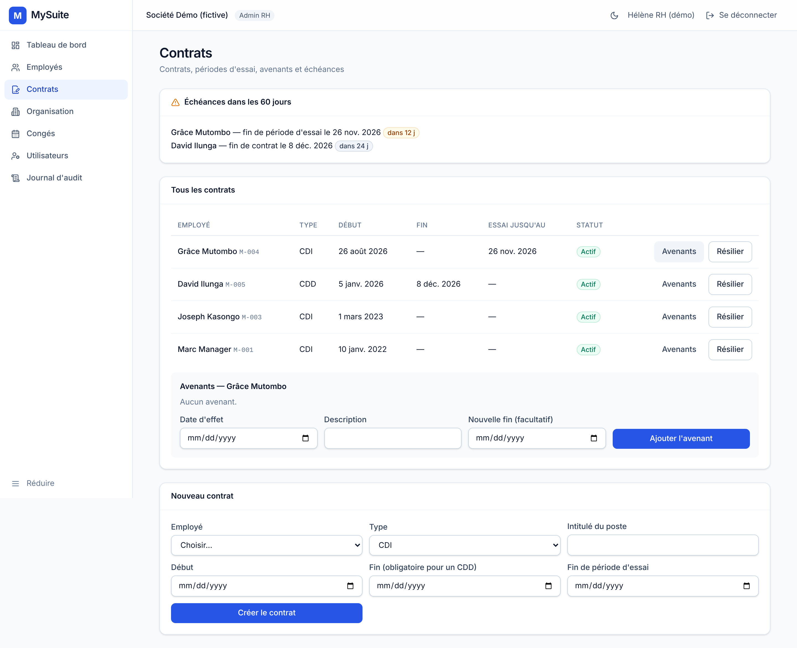

# Contrats

Réservé à l'admin RH et au gestionnaire RH (lecture : auditeur).

- **Nouveau contrat** : employé, type, intitulé du poste, début, fin (**obligatoire pour un CDD**), fin de période d'essai. Un seul contrat actif par employé.
- **Avenants** : description, date d'effet, nouvelle fin facultative ; l'historique est conservé.
- **Résiliation** : le contrat passe à `terminated` ; les échéances passées passent à `expired`.
- **Alertes** : contrats arrivant à échéance et fins de période d'essai.

Détails : [règles des contrats](../business-rules/contracts.md).
