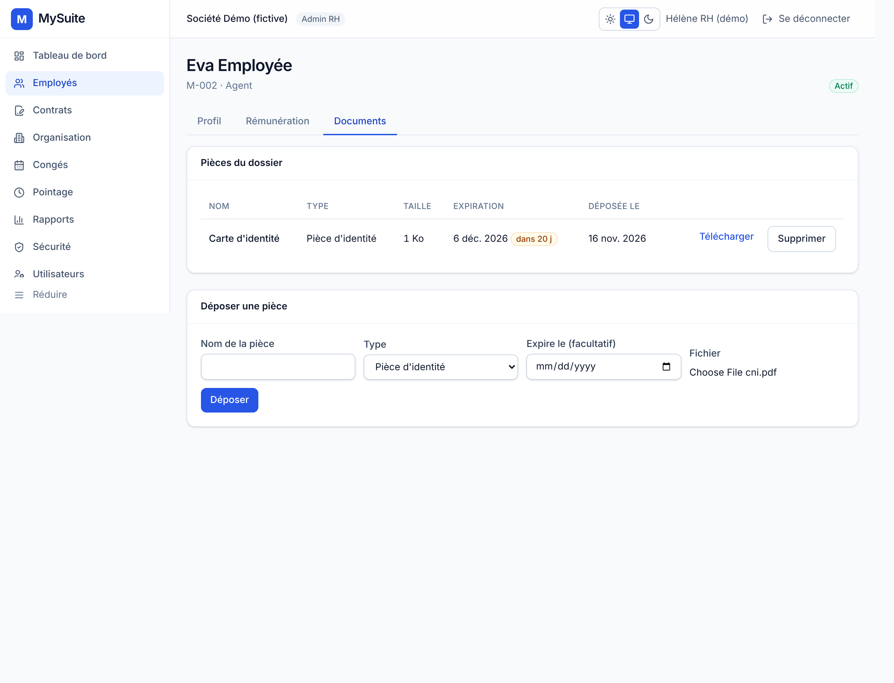
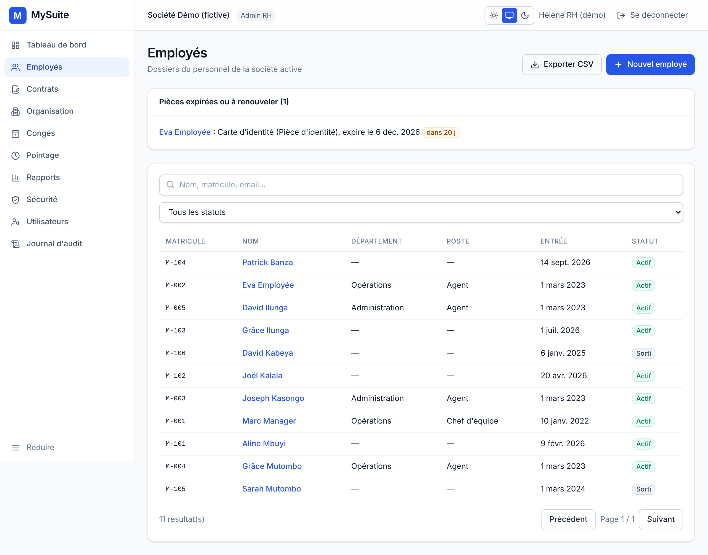

# Pièces des employés

Onglet *Documents* de la fiche employé (Admin RH et Gestionnaire RH uniquement).

## Dépôt

Types : pièce d'identité, diplôme, certificat, autre. Formats : **PDF, PNG, JPEG**, 5 Mo maximum. Le format est vérifié sur le **contenu** du fichier (signature des premiers octets), jamais sur l'extension ni sur le type déclaré par le navigateur : une page HTML renommée en `.pdf` est refusée. Une date d'expiration est facultative.

## Échéances

La liste des employés affiche les pièces expirées ou expirant dans les 60 jours (employés actifs ou en congé).

## Téléchargement et suppression

Le téléchargement est forcé (`attachment`, `nosniff`) et audité. La suppression **efface le contenu** ; seules les métadonnées (nom, type, taille, empreinte SHA-256, dates) restent pour l'audit.

## Sécurité et limites

- Permissions dédiées `documents_read` et `documents_manage` : ni les managers, ni la paie, ni l'auditeur n'y ont accès.
- Isolation par société : une pièce d'une autre société répond 404.
- Audit : `document.upload`, `document.download`, `document.delete`.
- Stockage en base (sauvegardé avec elle) : adapté à des pièces de quelques Mo ; pas d'antivirus ni de chiffrement applicatif de ces fichiers, à prévoir si les pièces sont très sensibles.
