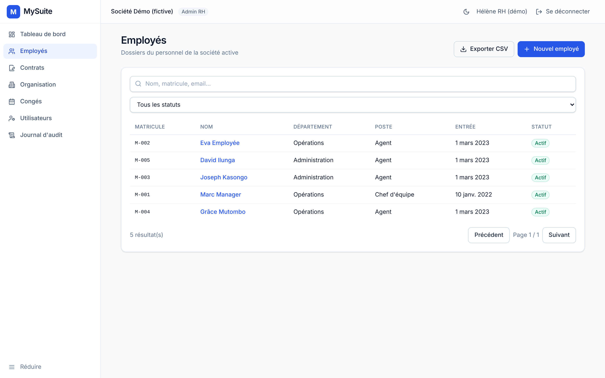
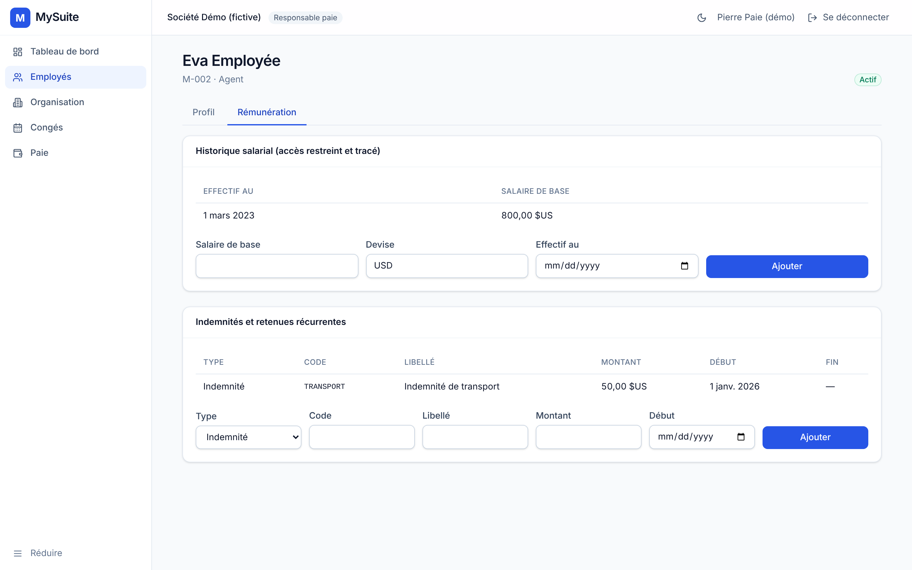

# Employés

## Liste

Recherche par nom, filtre par statut (`candidat`, `actif`, `suspendu`, `en congé`, `sorti`), pagination, export CSV (audité, avec neutralisation des formules).

## Créer un employé

Matricule (unique), nom, prénom, email, téléphone, naissance, date d'entrée, site, département, poste, manager, type de contrat (`cdi`, `cdd`, `stage`, `journalier`, `consultant`).

## Fiche et rémunération

- **Informations** : visibles par les rôles ayant `employees_read`.
- **Historique salarial** : salaire de base, devise, date d'effet. Accès restreint (`compensation_read`) ; chaque lecture est journalisée.
- **Indemnités et retenues récurrentes** : libellé, code, montant, type (*allowance* / *deduction*) ; elles alimentent le calcul de paie.

L'API expose `GET /employees/me` (dossier de l'utilisateur connecté) ; l'interface n'a pas encore de page « Mon profil » dédiée.
