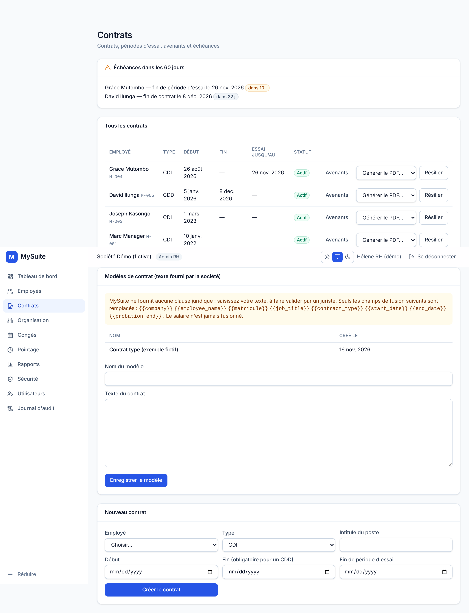

# Modèles de contrat et PDF

*Contrats → Modèles de contrat*. MySuite **ne fournit aucune clause juridique** : le texte est celui de votre société, à faire valider par un juriste avant usage.

## Champs de fusion

Remplacés à la génération : `{{company}}`, `{{employee_name}}`, `{{matricule}}`, `{{job_title}}`, `{{contract_type}}`, `{{start_date}}`, `{{end_date}}`, `{{probation_end}}` (dates au format JJ/MM/AAAA ; « non applicable » si absente). Un champ inconnu ou mal fermé refuse l'enregistrement du modèle. **Le salaire n'est jamais fusionné** : une société qui doit le faire figurer dans le contrat le rédige elle-même.

## Générer le PDF

Dans la liste des contrats, *Générer le PDF…* propose les modèles de la société. Le PDF (A4, texte, pagination automatique) est téléchargé.

## Droits et audit

- Lecture des modèles et génération : `contracts_read` ; création de modèle : `contracts_manage`.
- Chaque modèle est propre à une société (un autre tenant reçoit 404).
- Audit : `contract_template.create`, `contract.document`.
- Un modèle n'est pas modifiable : créez-en un nouveau pour garder l'historique des textes utilisés.

## Limites

Police standard (accents français et €, autres caractères remplacés par `?`), pas de mise en forme (gras, tableaux), pas de signature électronique.
