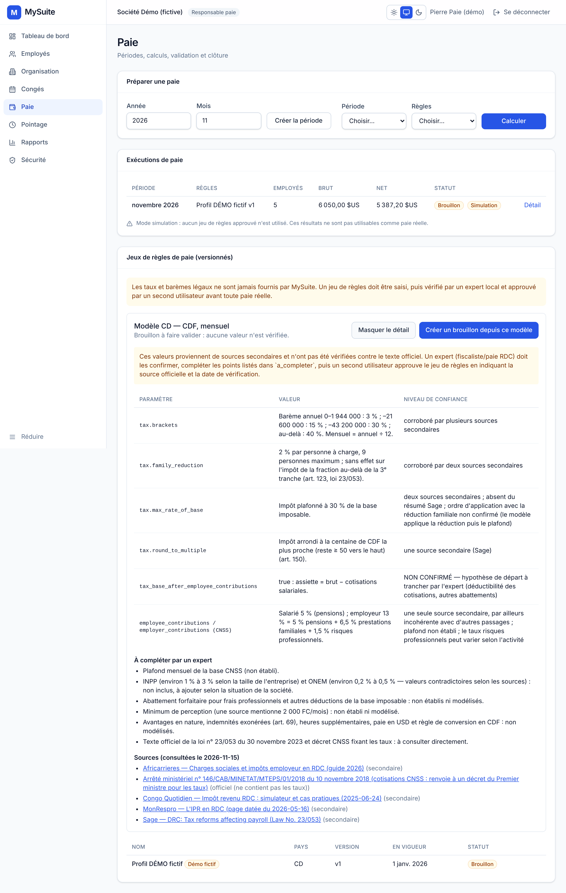
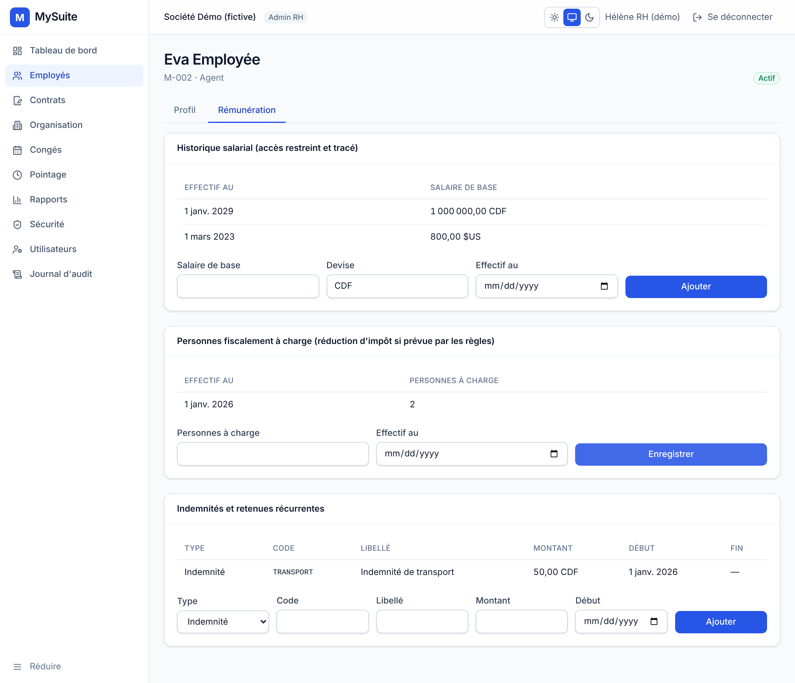
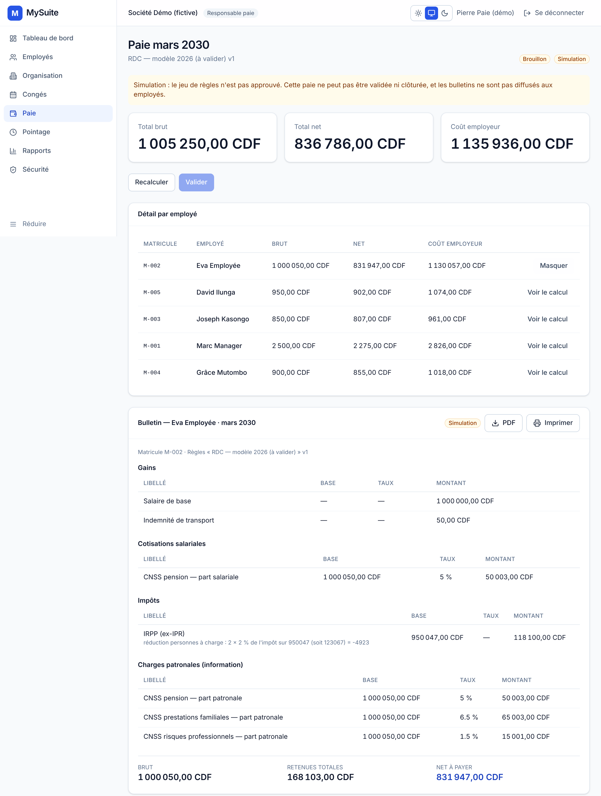

# Pack paie RDC

!!! danger "Aucune valeur n'est vérifiée"
    Le modèle RDC est un **brouillon de départ**. Ses valeurs viennent de **sources secondaires** (résumés d'éditeurs de paie, presse, cabinets), consultées le **15/11/2026**. Le texte officiel de la loi n° 23/053 et le décret fixant les taux CNSS **n'ont pas été consultés directement**. Un expert (fiscaliste ou paie RDC) doit tout confirmer avant une paie réelle. MySuite ne l'approuve jamais automatiquement.

## Contexte légal (à confirmer)

Le site officiel de la CNSS (cnss.cd) n'a pas pu être consulté depuis mon environnement. Selon les sources consultées, l'**IPR** (ordonnance-loi n° 69/009) est remplacé par l'**IRPP** (loi n° 23/053 du 30 novembre 2023) à compter du **1er janvier 2026**. Le barème progressif et les taux sont décrits comme inchangés. Le modèle nomme donc l'impôt « IRPP (ex-IPR) ».

## Ce que contient le modèle

Montants **mensuels, en CDF** (barème annuel ÷ 12).

| Élément | Valeur du modèle | Confiance |
|---|---|---|
| Barème | 3 % jusqu'à 162 000 ; 15 % jusqu'à 1 800 000 ; 30 % jusqu'à 3 600 000 ; 40 % au-delà | Corroboré par plusieurs sources secondaires |
| Personnes à charge | −2 % de l'impôt par personne, 9 maximum, sans effet sur la fraction au-delà de la 3ᵉ tranche (art. 123) | Deux sources secondaires |
| Plafond de l'impôt | 30 % de l'assiette | Deux sources ; l'ordre avec la réduction familiale n'est pas confirmé (le modèle réduit puis plafonne) |
| Arrondi | Impôt arrondi à la centaine de CDF (reste ≥ 50 vers le haut) (art. 150) | Une source |
| Assiette fiscale | Brut − cotisations salariales | **Non confirmé** : hypothèse à trancher |
| CNSS | Salarié 5 % ; employeur 13 % (5 % pensions + 6,5 % prestations familiales + 1,5 % risques professionnels), d'après le [décret n° 18/041 du 24/11/2018](https://www.droitcongolais.info/files/830.11.18.8-Decret-du-24-novembre-2018_taux-de-cotisation-cnss.pdf) | **Texte du décret**, lu via une base juridique en ligne : à confirmer contre le Journal officiel. Aucun plafond n'y figure |

## Ce qui reste à compléter

- **CNSS** : le décret prévoit un **taux transitoire de 4 %** (au lieu de 6,5 %) pour les prestations familiales dans l'**ex-province du Katanga** ; sa durée n'est pas connue. Il fixe aussi un **plancher** : la base de cotisation ne peut pas être inférieure au SMIG (art. 8), non modélisé. Aucun plafond n'y figure ; une source secondaire en évoque un par arrêté, non établi.
- **INPP** (environ 1 à 3 % selon la taille de l'entreprise) et **ONEM** : valeurs contradictoires, non incluses.
- Abattement pour frais professionnels et autres déductions de la base : non établis, non modélisés.
- Minimum de perception, avantages en nature, indemnités exonérées, heures supplémentaires.
- **Devises** : le modèle est en CDF. MySuite ne convertit pas. Une société en USD verra un avertissement rouge et ne doit pas l'utiliser en l'état.

## Utiliser le modèle

1. **Paie** → section *Jeux de règles* → *Voir le détail et les sources* : chaque paramètre est présenté avec son niveau de confiance et ses liens.
2. *Créer un brouillon depuis ce modèle*. Le jeu est créé en **brouillon** (version 1).
3. L'expert corrige les valeurs (création d'une nouvelle version via l'API `POST /payroll/rule-sets`, qui incrémente la version) et complète les points ouverts.
4. Une **autre personne** l'approuve en saisissant la **source officielle** (texte, article) et la **date de vérification**.
5. Tant que le jeu n'est pas approuvé, toute paie est une **simulation** : non validable, bulletins non diffusés.

## Personnes à charge

Fiche employé → *Rémunération* → *Personnes fiscalement à charge*. Valeur **datée** (historique conservé) ; la paie d'un mois utilise la dernière valeur en vigueur à la fin du mois ; sans valeur, 0. Accès : mêmes permissions que la rémunération (admin RH, responsable paie), consultations non tracées mais saisies **auditées** (`employee.dependents`).

## Bulletin

La réduction est **expliquée sur la ligne d'impôt** (nombre de personnes, taux, impôt éligible, montant) à l'écran et sur le PDF ; un plafonnement éventuel y figure aussi.

## Exemple de contrôle

Source secondaire : 475 000 CDF/mois, sans cotisations. Impôt = 4 860 + 313 000 × 15 % = **51 810**. Avec 3 personnes à charge : −6 % → 48 701,40. Le moteur le reproduit (tests automatiques), puis arrondit à la centaine : 51 800 et 48 700.

## Sources

Liste complète avec liens dans l'écran du modèle ; principales : [Sage](https://communityhub.sage.com/za/sage-payroll-professional/f/announcements/257553/democratic-republic-of-congo-drc-tax-reforms-affecting-payroll-law-no-23-053), [Congo Quotidien](https://www.congoquotidien.com/2025/06/24/impot-revenu-rdc-simulateur-cas-pratiques/), [MonRespro](https://business.monrespro.com/blog/ipr-impot-professionnel-remunerations-rdc), [Africarrieres](https://africarrieres.com/rd-congo/pt/guide/employeur-entreprise/charges-employeur), [arrêté CNSS du 10/11/2018](https://www.droitcongolais.info/files/830.11.18.3-Arrete-du-10-novembre-2018_affiliation_cotisations.pdf) (renvoie à un décret pour les taux).
