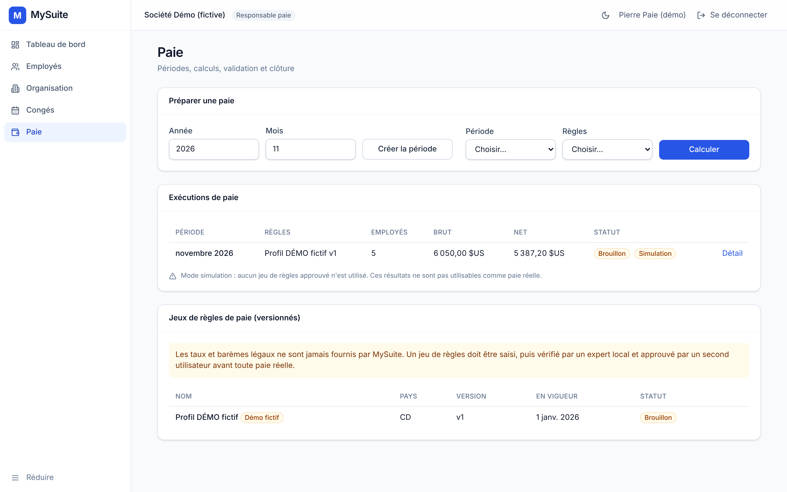
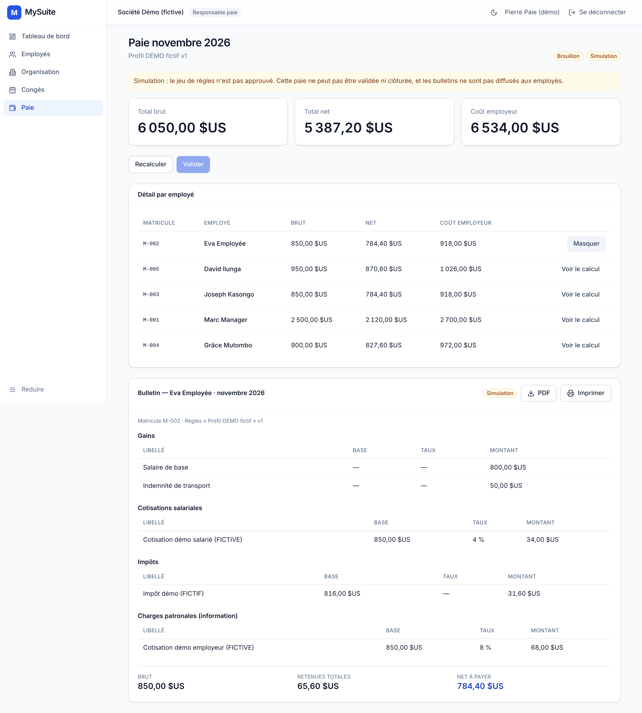

# Paie



## Cycle de vie

```text
Jeu de règles (brouillon) ──approbation par une 2e personne──▶ approuvé
        │
        ▼
Période ──▶ Exécution (brouillon) ◀──recalcul──┐
                  │                            │
                  └──────────valider──▶ validée ──clôturer──▶ clôturée (figée)
```

1. **Jeu de règles** (responsable paie) : arrondi, cotisations salariales et patronales (taux, base, plafond), barème de l'impôt, assiette. Obligatoires pour approuver : **source officielle** et **date de vérification**. Un jeu de démonstration ne peut pas être approuvé.
2. **Approbation** : par une autre personne que le créateur (`PAYROLL_FOUR_EYES=true`).
3. **Période** puis **Préparer une paie** : une seule paie non clôturée par période. Option **simulation** : calcul sans effet, jamais validable.
4. **Recalcul** tant que la paie est en brouillon.
5. **Validation** puis **clôture** : les lignes sont figées.

## Détail du calcul



Pour chaque employé : brut, cotisations, assiette fiscale, impôt par tranches, retenues, net et coût employeur, avec le détail ligne par ligne. Les données d'entrée sont figées avec la ligne (`payroll_items.input`).

## Bulletins

Un bulletin PDF est généré sans dépendance externe, avec les mêmes contrôles d'accès que l'écran ; le téléchargement est audité (`payslip.download`). La mention **SIMULATION** apparaît si la paie n'est pas approuvée. Les employés voient leurs bulletins dans **Mes bulletins** (paies clôturées uniquement).

## Ce qui n'est pas géré

Heures supplémentaires, prorata d'entrée/sortie en cours de mois, multi-devise, régularisations, avances et prêts. Voir [règles de paie](../business-rules/payroll.md) et [feuille de route](../roadmap.md).
