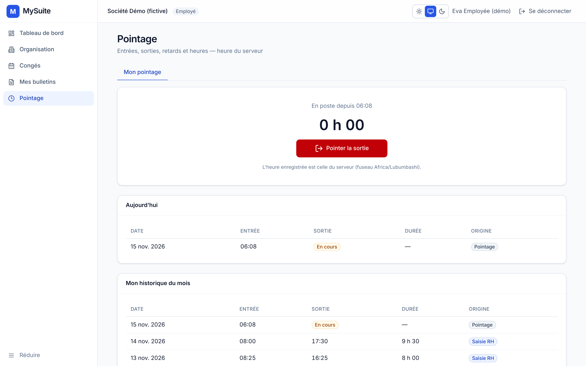
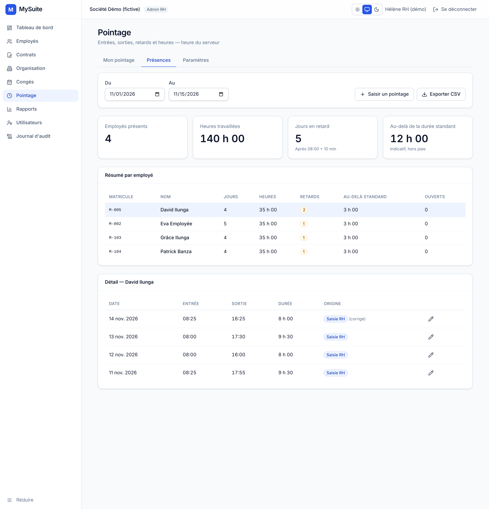
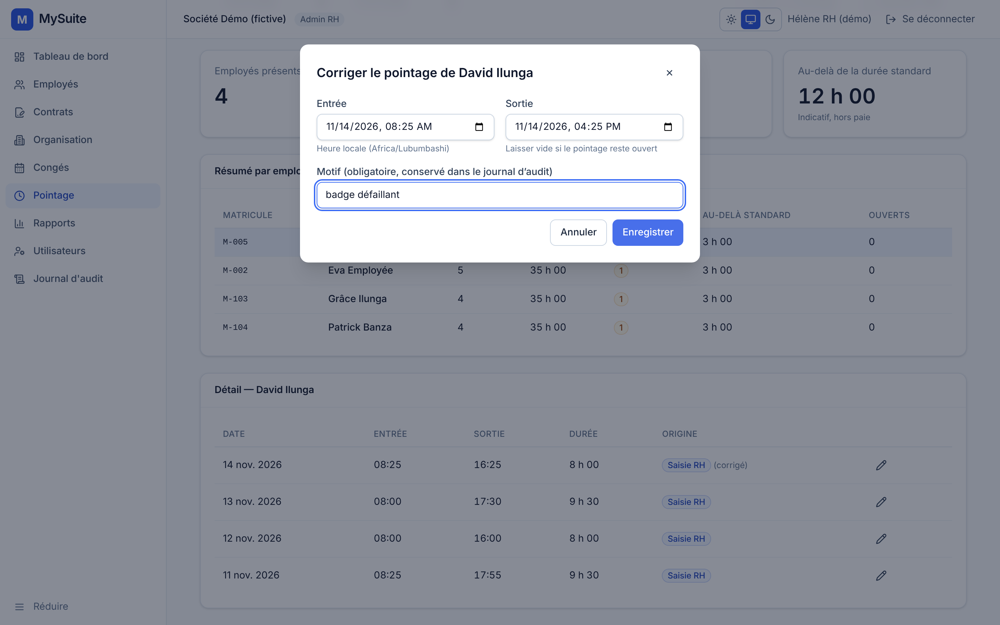

# Pointage

=== "Mon pointage"
    

    **Entrée** / **Sortie** en un clic. L'heure est celle du **serveur**. Un seul pointage ouvert à la fois. L'historique du mois affiche vos journées.

=== "Équipe (manager / RH)"
    

    Résumé par employé : jours, heures travaillées, jours en retard, minutes au-delà de la durée standard (indicatives), pointages ouverts. Export CSV audité.

=== "Correction RH"
    

    Saisie ou correction d'un pointage avec **motif obligatoire** ; audit avant/après. On ne corrige jamais son propre pointage.

## Paramètres

| Paramètre | Rôle |
|---|---|
| Fuseau horaire | Détermine la date locale d'une journée |
| Heure de début de journée | Référence du retard |
| Tolérance de retard (minutes) | Retard si première entrée > début + tolérance |
| Durée journalière standard (minutes) | Seuil du « au-delà de la durée standard » |

Sur mobile : voir la [capture](../screenshots/26-pointage-mobile.png). Règles complètes : [règles du pointage](../business-rules/attendance.md).
