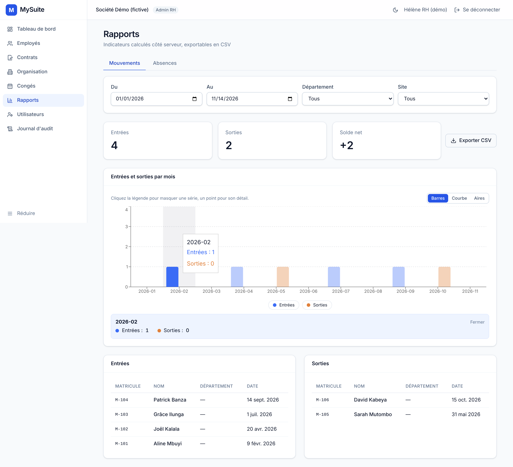
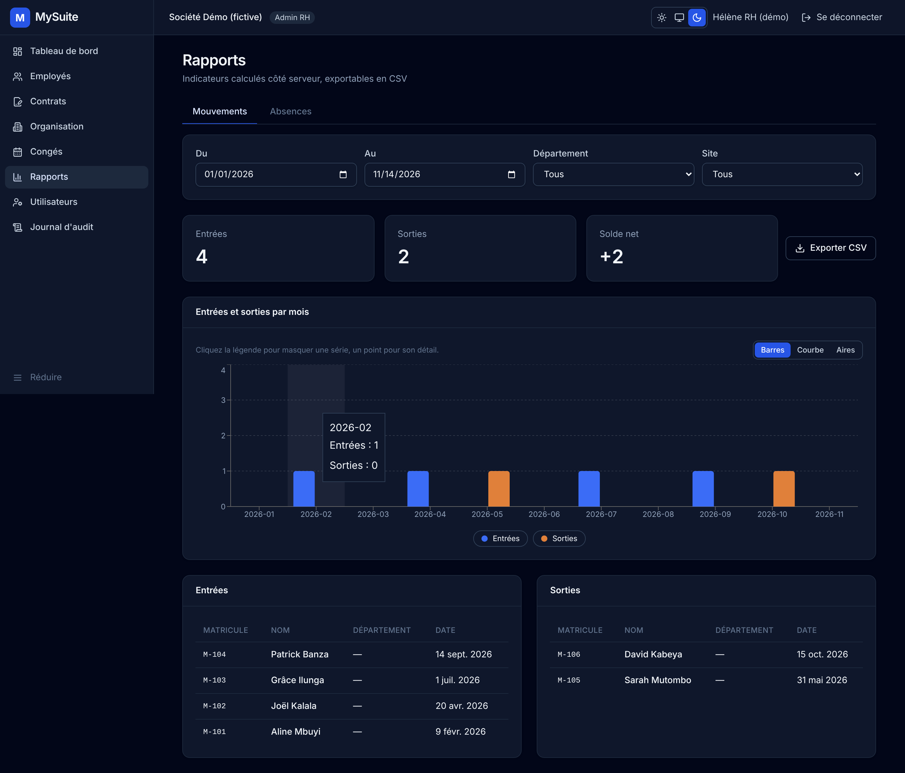

# Rapports

| Rapport | Contenu | Accès |
|---|---|---|
| Mouvements | Entrées et sorties par mois | `reports_read` |
| Absences | Jours d'absence approuvés, par type et département | `reports_read` |
| Masse salariale | Brut, net, coût employeur cumulés (paies **clôturées** non simulées) | + permission paie |

Filtres : année, département, site. Graphiques **interactifs** : infobulles, légende cliquable, bascule barres/courbe/aires, clic pour le détail. Export **CSV** audité (BOM UTF-8). Thème sombre pris en charge.

