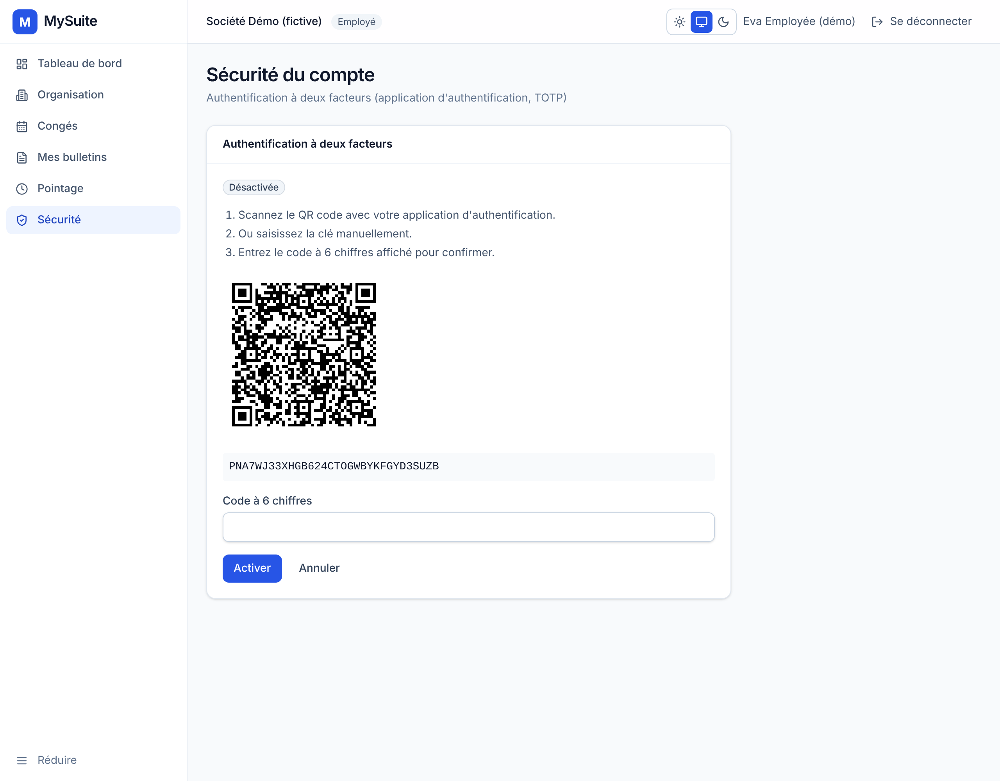
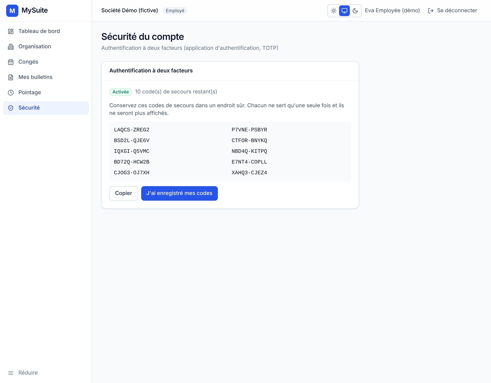
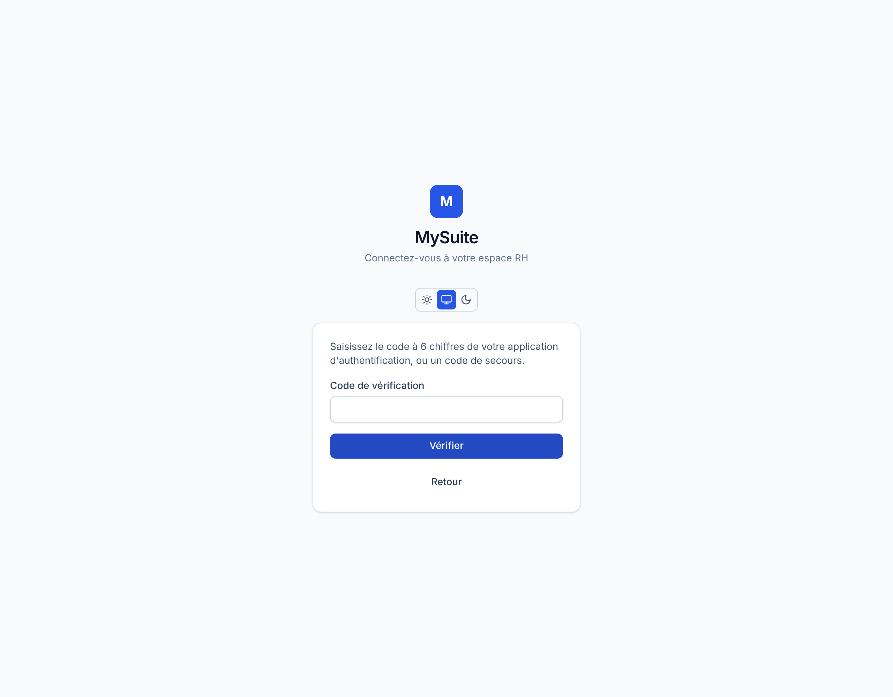
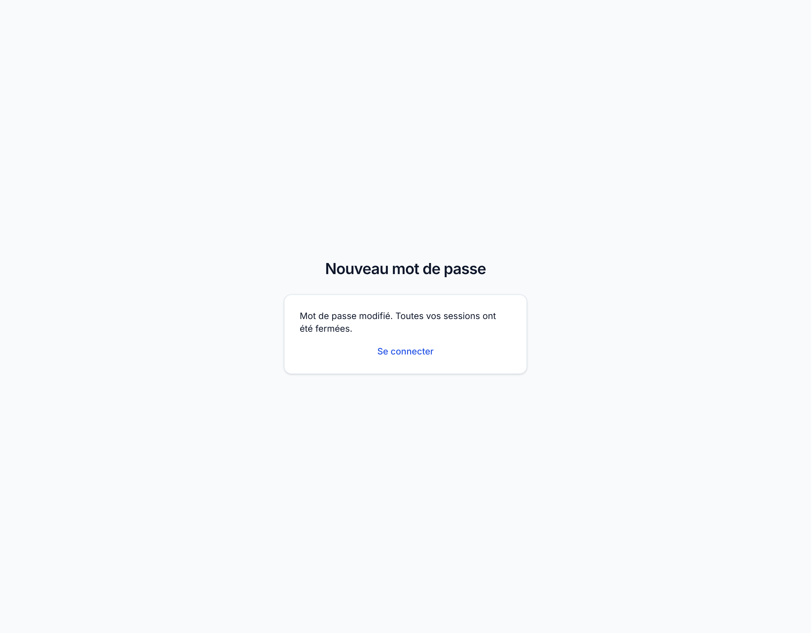
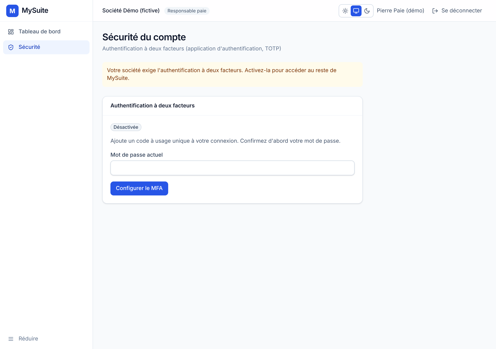

# Sécurité du compte

Page **Sécurité** (tous les utilisateurs).

## Activer le MFA

1. Saisir votre **mot de passe actuel** → *Configurer le MFA*.
2. Scanner le QR code (Google Authenticator, Aegis, 1Password…) ou saisir la clé manuellement.
3. Entrer le code à 6 chiffres → *Activer*.
4. Conserver les **10 codes de secours** (affichés une seule fois).

## Se connecter avec le MFA

Mot de passe, puis code à 6 chiffres **ou** un code de secours (usage unique). Cinq échecs verrouillent le compte 15 minutes.

## Désactiver / régénérer les codes

Exige votre mot de passe **et** un code (application ou secours). Régénérer invalide les anciens codes.

## Mot de passe oublié

Il n'y a pas d'envoi d'email : demandez un **lien de réinitialisation** à votre administrateur RH ([voir Utilisateurs](utilisateurs.md#lien-de-reinitialisation-de-mot-de-passe)).

Détails techniques : [modèle de sécurité](../security/security-model.md#mfa-totp-et-reinitialisation-de-mot-de-passe).

## MFA obligatoire pour la société

*Sécurité* → *Politique de la société* (rôles avec la gestion des utilisateurs). La case « Exiger l'authentification à deux facteurs » impose le MFA à tous les membres.

- **Prérequis** : l'administrateur doit avoir activé son propre MFA, sinon la règle est refusée (il se verrouillerait lui-même).
- **Effet** : un membre sans MFA reste connecté mais **toute requête métier répond 403 `mfa_enrollment_required`** ; l'interface le redirige vers *Sécurité*, seul écran utilisable. Ses permissions ne sont plus exposées. Dès que le MFA est activé, la même session est débloquée (le contrôle est refait à chaque requête).
- **Désactivation** : décocher la case rend l'accès immédiatement aux membres sans MFA. Un membre qui désactive son MFA alors que la règle est active est de nouveau bloqué.
- **Audit** : `tenant.mfa_policy`.
- **Limite** : la règle s'applique par société ; un utilisateur membre de plusieurs sociétés n'est bloqué que dans celles qui l'exigent.
