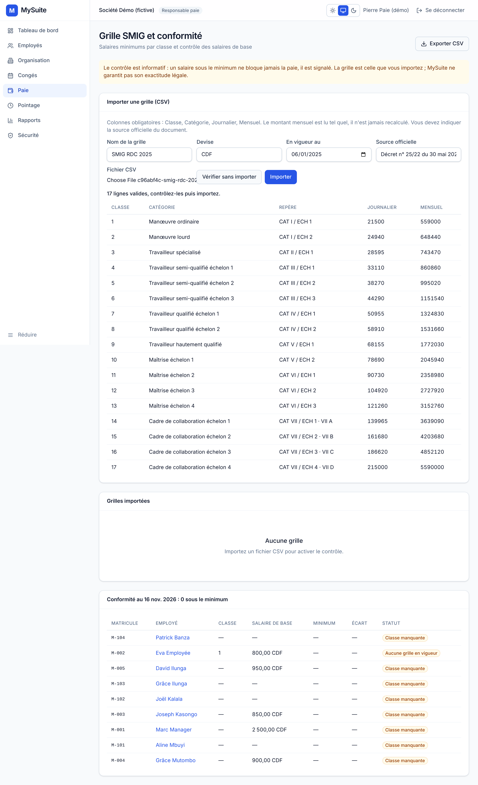
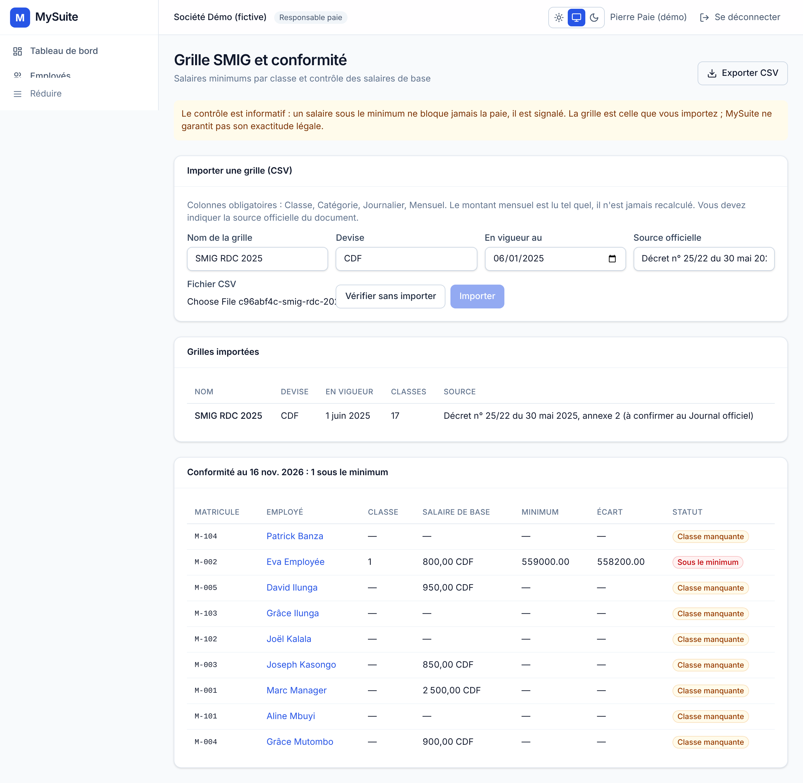

# Grille SMIG et conformité

Cette page décrit l'import d'une grille de salaires minimums, l'affectation d'une classe à chaque employé et le rapport de conformité.

## Importer une grille

*Paie → Grille SMIG et conformité* (responsable paie). Fichier CSV avec les colonnes **Classe, Catégorie, Journalier, Mensuel** (facultatives : *Repère paie*, *Tension*). Vous indiquez le nom, la devise, la date d'entrée en vigueur et la **source officielle**.

- *Vérifier sans importer* contrôle le fichier et affiche les lignes ; rien n'est écrit.
- Le montant **mensuel est lu tel quel** dans le fichier, il n'est jamais déduit du journalier (la convention de calcul, par exemple journalier × 26, reste à confirmer avec la source officielle).
- Une classe en double, un montant non positif ou une colonne manquante refusent tout l'import.

## Classe par employé

Fiche employé → *Rémunération* → *Classe de la grille SMIG*. Valeur datée, historique conservé, saisie auditée (`employee.wage_class`). Sans classe, aucun contrôle ni plancher n'est appliqué.

## Rapport de conformité

Compare le salaire de base en vigueur au minimum mensuel de la classe. Statuts : conforme, sous le minimum (avec l'écart), classe manquante, salaire manquant, aucune grille, devises différentes. **Informatif : la paie n'est jamais bloquée.** Export CSV disponible. Les consultations et exports sont audités (`wage_grid.compliance_read`, `wage_grid.compliance_export`).

## Plancher de la base CNSS

Dans le modèle RDC, les lignes CNSS ont l'option `floor_to_minimum_wage` : la base de cotisation n'est pas inférieure au minimum de la classe (décret 18/041, art. 8, à confirmer au Journal officiel). La ligne du bulletin l'explique.

## Limites

Les valeurs de la grille sont celles que vous importez. Le décret 25/22 du 30 mai 2025 n'a pas été confirmé de façon indépendante, ni la date d'effet.
