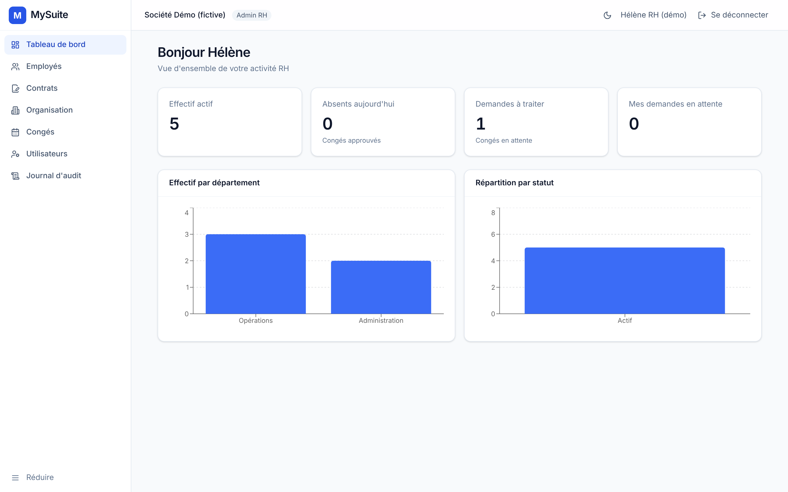
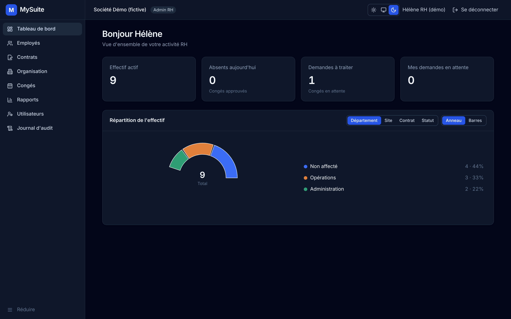

# Tableau de bord

Vue d'ensemble adaptée au rôle : effectif actif, absents aujourd'hui, demandes à traiter (managers et RH), mes demandes en attente, et **répartition de l'effectif** par département, site, type de contrat ou statut.

- L'anneau est **interactif** : survol pour le détail, clic pour isoler une part.
- Le sélecteur *Dimension* change le regroupement.
- Thème clair/sombre/système dans l'en-tête.

