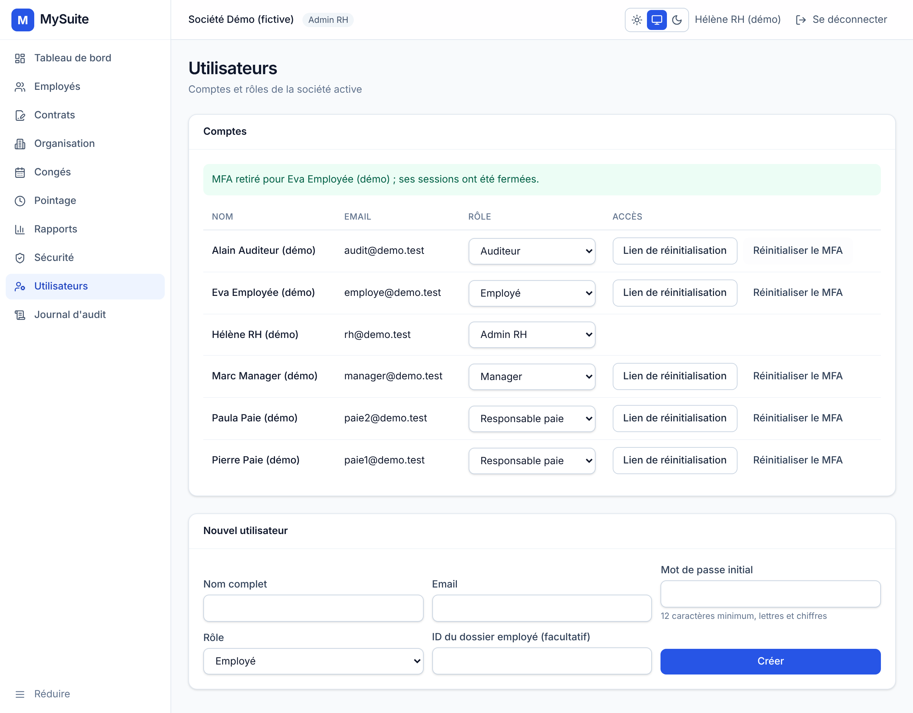
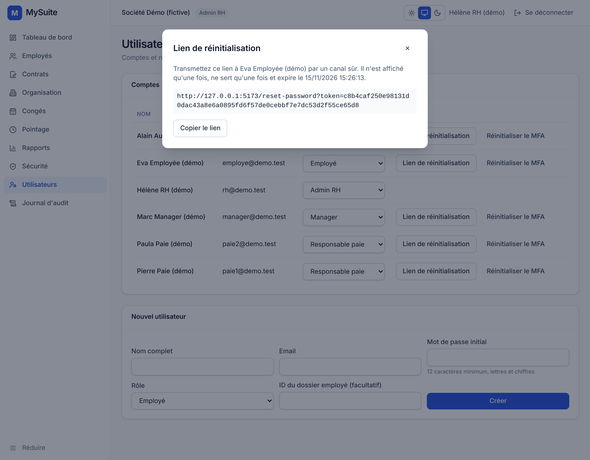

# Utilisateurs

Réservé à l'admin RH (`users_manage`).

## Créer un utilisateur

Nom, email, mot de passe initial (12 caractères minimum, lettres et chiffres), rôle, dossier employé facultatif. Le rôle se change ensuite depuis la liste ; l'effet est immédiat.

## Lien de réinitialisation de mot de passe { #lien-de-reinitialisation-de-mot-de-passe }

*Lien de réinitialisation* génère un lien **à usage unique valable 1 heure**, affiché **une seule fois**. Transmettez-le par un canal fiable. Son usage change le mot de passe, **ferme toutes les sessions** et lève un éventuel verrouillage. Un nouveau lien invalide le précédent. Impossible sur soi-même, sur un administrateur de plateforme ou un utilisateur d'une autre société.

**Envoi par courriel (facultatif)** : si le serveur est configuré avec SMTP ([configuration](../demarrage/configuration.md)), le lien est aussi envoyé à l'adresse du compte ; l'écran indique si l'envoi a réussi. Sans SMTP, ou en cas d'échec, le lien affiché reste à transmettre à la main. Le lien est construit à partir de `APP_BASE_URL`.

## Réinitialiser le MFA { #reinitialiser-le-mfa }

*Réinitialiser le MFA* retire le second facteur (téléphone perdu), ferme les sessions de la personne et est journalisé (`mfa.admin_reset`). Pas sur soi-même.

!!! tip
    Après une réinitialisation, demandez à la personne de reconfigurer son MFA immédiatement.
