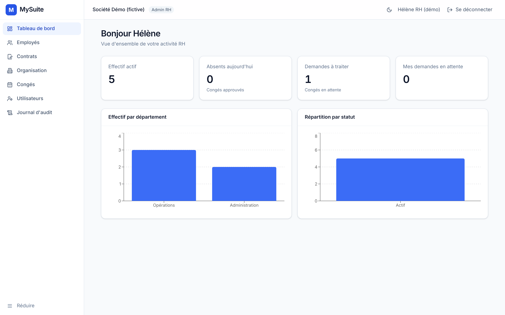

# MySuite

**Suite RH multi-sociétés** inspirée des logiciels RH professionnels : dossiers du personnel, contrats, congés, paie, pointage et badgeuses, rapports, sécurité et audit. Backend **Rust** (Axum, SQLx, PostgreSQL), frontend **React + TypeScript**.

## Principes non négociables

- :material-shield-lock: **Isolation stricte des sociétés**

    L'identifiant de société vient uniquement de la session, jamais de la requête. Hors périmètre, l'API répond 404.

- :material-calculator-variant: **Paie déterministe et auditable**

    Moteur de calcul pur, règles versionnées, données d'entrée figées, aucun taux légal codé en dur.

- :material-account-key: **Autorisations côté serveur**

    Matrice de permissions par rôle appliquée dans chaque handler ; l'interface ne fait que masquer.

- :material-notebook-check: **Journal d'audit en ajout seul**

    Les actions sensibles sont tracées dans la même transaction que la modification.

## Par où commencer ?

| Vous êtes… | Lisez |
|---|---|
| Responsable de l'installation | [Installation](demarrage/installation.md), [Configuration](demarrage/configuration.md), [Déploiement](operations/deployment.md) |
| Administrateur RH | [Premiers pas](demarrage/premiers-pas.md), [Rôles et permissions](guide/roles.md), [Utilisateurs](guide/utilisateurs.md) |
| Responsable de paie | [Paie](guide/paie.md), [Règles de paie](business-rules/payroll.md) |
| Manager ou employé | [Congés](guide/conges.md), [Pointage](guide/pointage.md), [Sécurité du compte](guide/securite-compte.md) |
| Développeur | [Environnement](developpement/environnement.md), [Architecture](architecture/overview.md), [Contribuer](developpement/contribuer.md) |
| Auditeur / sécurité | [Modèle de sécurité](security/security-model.md), [Journal d'audit](guide/audit.md) |

## Modules

| Module | Ce qu'il fait | Guide | Règles métier |
|---|---|---|---|
| Organisation | Sites, départements, postes | [Guide](guide/organisation.md) | — |
| Employés | Dossiers, rémunération, indemnités et retenues | [Guide](guide/employes.md) | — |
| Contrats | Création, avenants, résiliation, alertes | [Guide](guide/contrats.md) | [Règles](business-rules/contracts.md) |
| Congés | Types, soldes, demandes, approbation | [Guide](guide/conges.md) | [Règles](business-rules/leave.md) |
| Paie | Jeux de règles, périodes, calcul, bulletins PDF | [Guide](guide/paie.md) | [Règles](business-rules/payroll.md) |
| Pointage | Entrée/sortie, corrections, résumés | [Guide](guide/pointage.md) | [Règles](business-rules/attendance.md) |
| Badgeuses | API appareil, import CSV, journal | [Guide](guide/badgeuses.md) | [Règles](business-rules/attendance.md#badgeuses-ingestion) |
| Rapports | Mouvements, absences, masse salariale | [Guide](guide/rapports.md) | [Règles](business-rules/reports.md) |
| Sécurité du compte | MFA TOTP, codes de secours, réinitialisation | [Guide](guide/securite-compte.md) | [Sécurité](security/security-model.md) |

!!! warning "Limites à connaître"
    MySuite **ne contient aucune règle légale ou fiscale préremplie**. Le pack RDC (CNSS, IPR…) doit être saisi par un expert, avec source officielle et date de vérification, puis approuvé par une seconde personne. Voir [Feuille de route](roadmap.md) pour tout ce qui n'est pas encore livré.
